# Lab 3: REST API, Query Parameters, Validation and Debugging

**Name:** BORAVELLI GNANASAHITYA REDDY  
**Registration Number:** Enter your registration number  
**Section:** Enter your section

## Objective

To develop a REST API with search, sorting, pagination, price filtering, validation and proper HTTP status codes.

## Technologies Used

- Node.js
- Express.js
- SQLite
- Postman
- VS Code

## How to Run

1. Install Node.js.
2. Open the project folder in VS Code.
3. Install dependencies:

   npm install

4. Start the server:

   npm start

5. Open:

   http://localhost:3000

## API Endpoints

| Method | Endpoint | Description |
|---|---|---|
| GET | /books | Get books with search and filters |
| GET | /books/:id | Get a single book |
| POST | /books | Add a new book |
| PUT | /books/:id | Update a book |
| DELETE | /books/:id | Delete a book |

## Query Parameters

- search_q: Search by title
- order_by: Sort by id, title, author or price
- order: ASC or DESC
- limit: Number of books
- offset: Starting position
- min_price: Minimum price
- max_price: Maximum price

## Screenshots
GET – Retrieve All Books
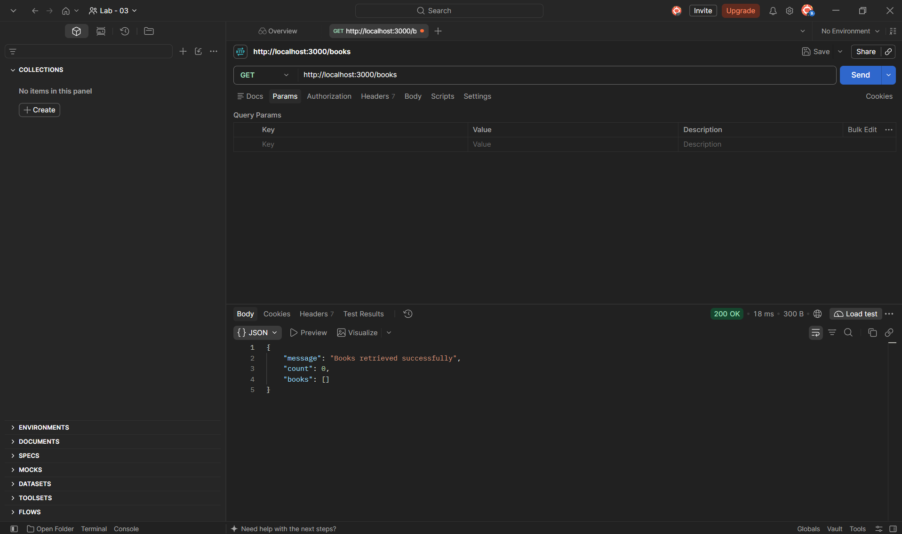

POST – Add a New Book
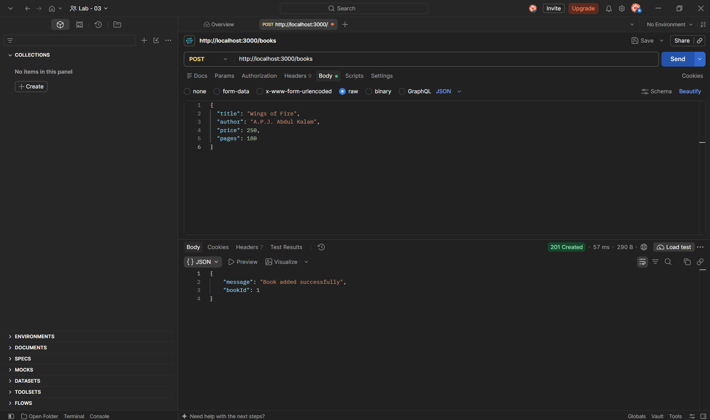

PUT – Update an Existing Book
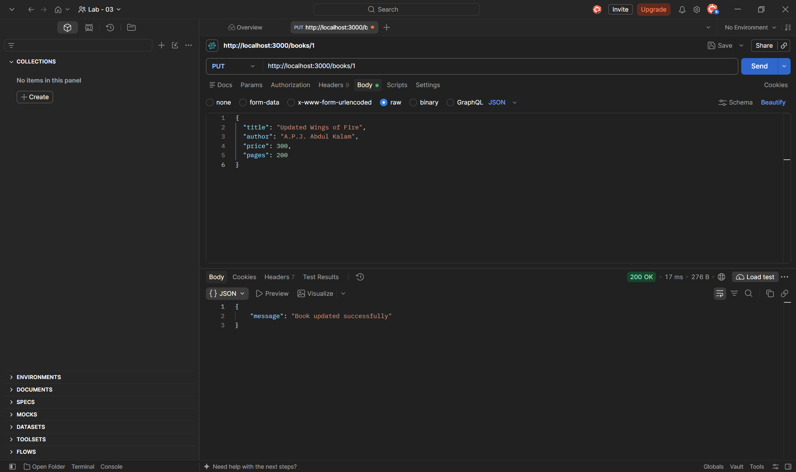

DELETE – Delete a Book

GET – Verify Book Deletion
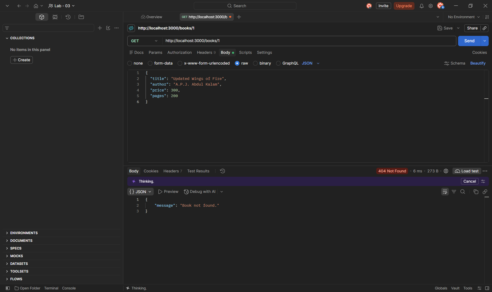

Add Book - First Record

Add Book - Second Record
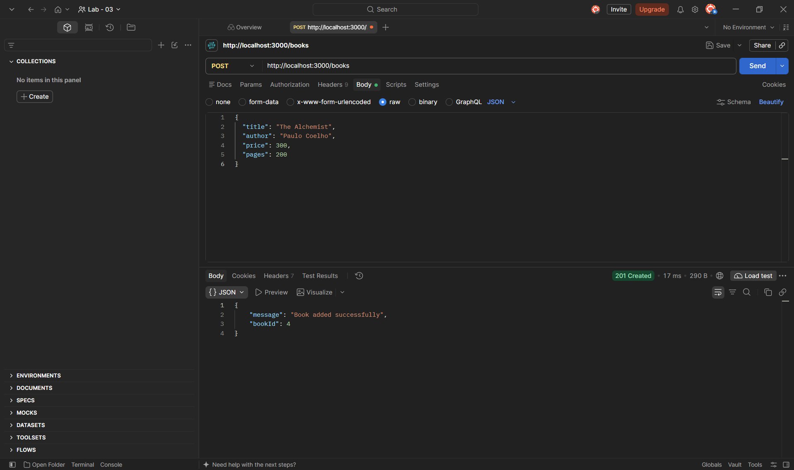

Search Books
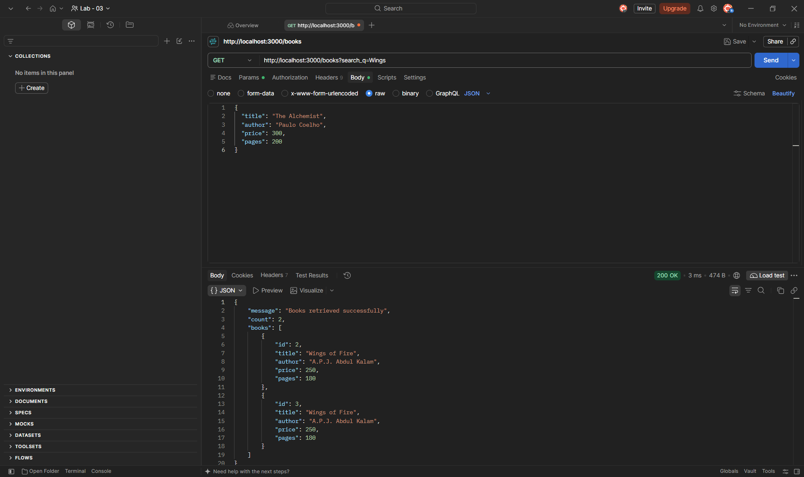

Sort Books
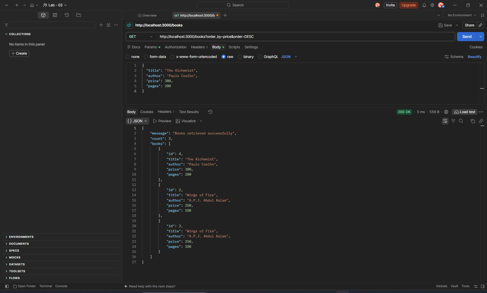

Pagination
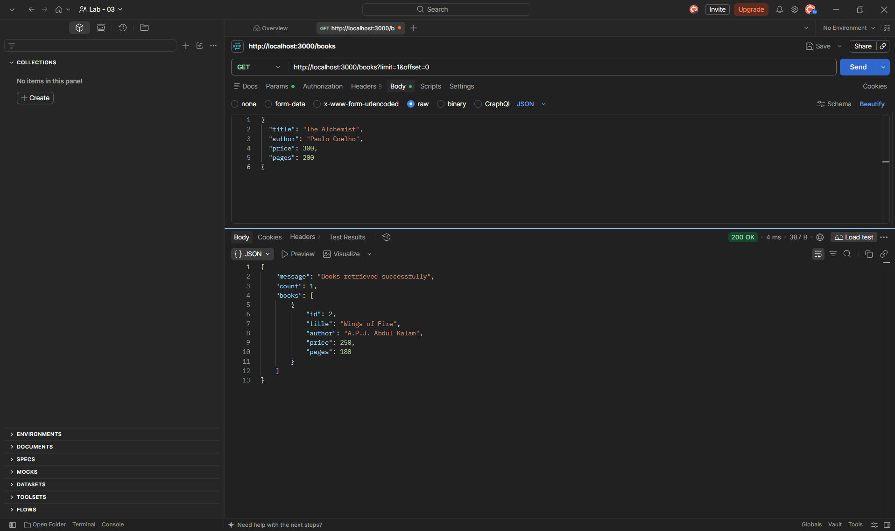

Price - Filter
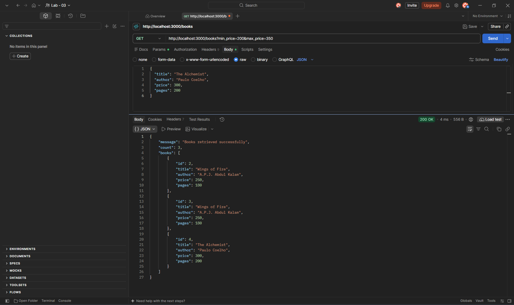

Validation - Error
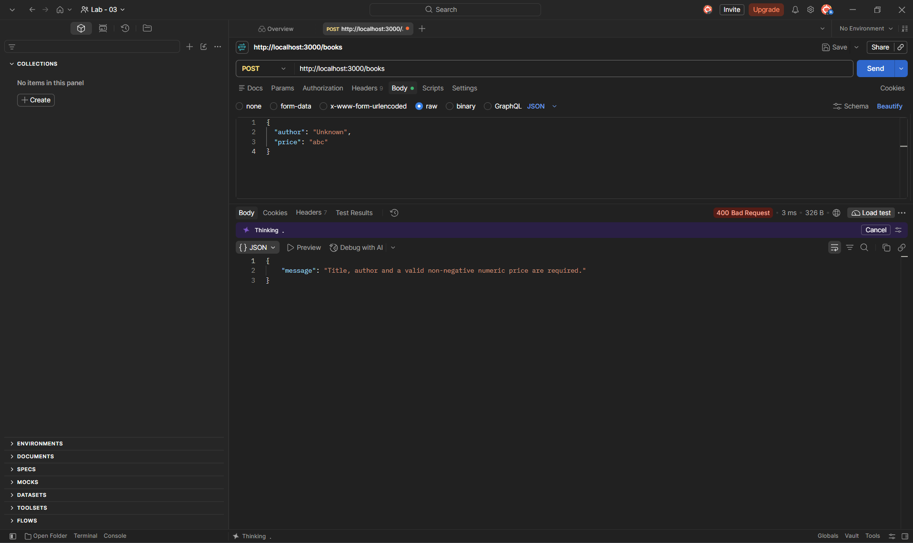

Not - Found - Error
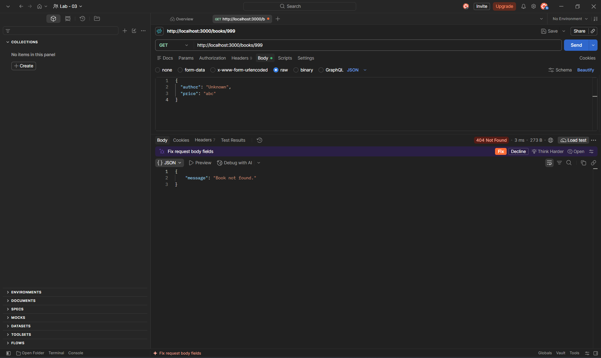

## Problems Faced and Solutions

To be updated after testing and debugging.
